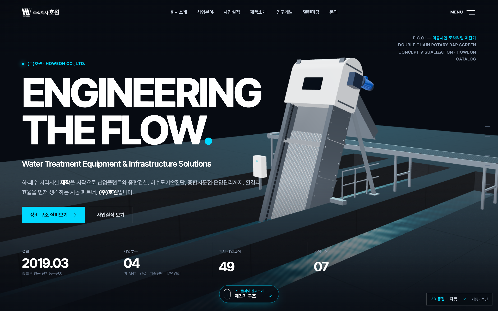
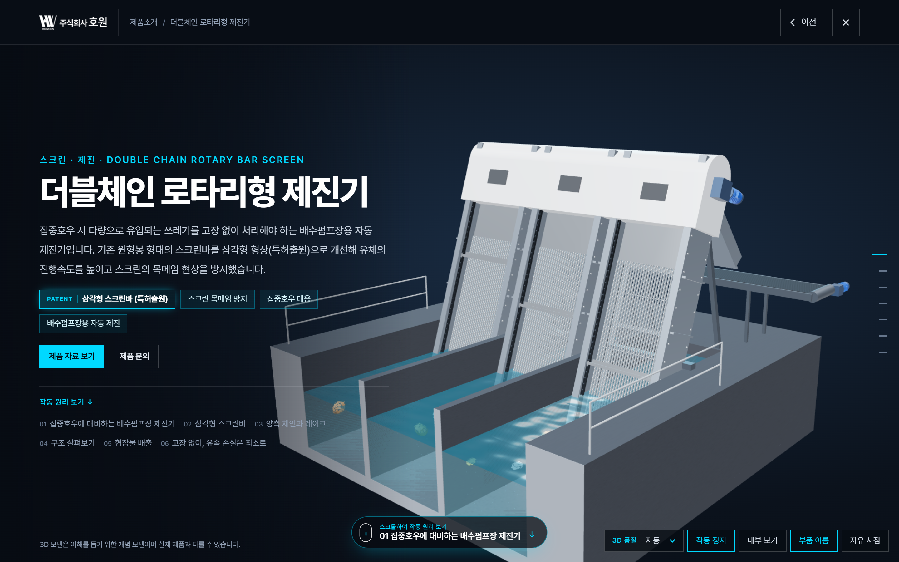
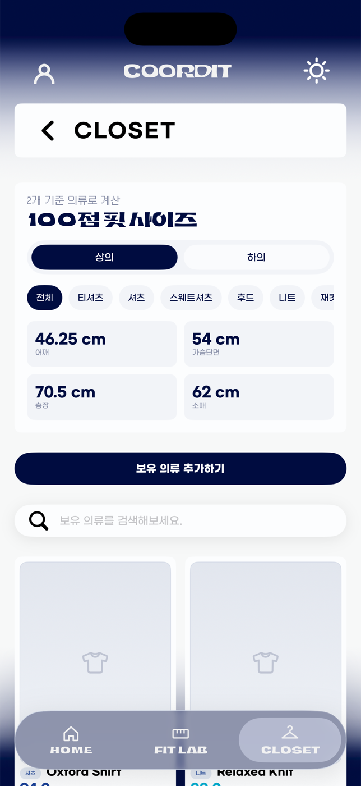
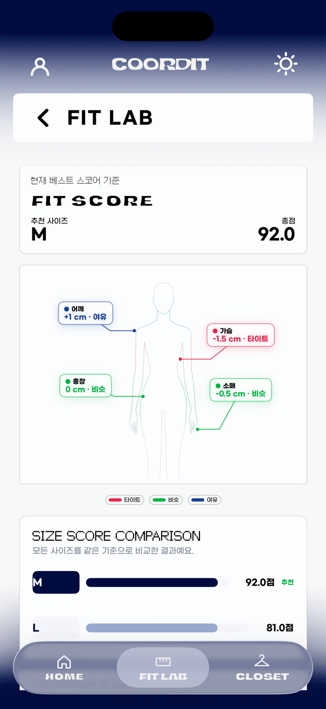
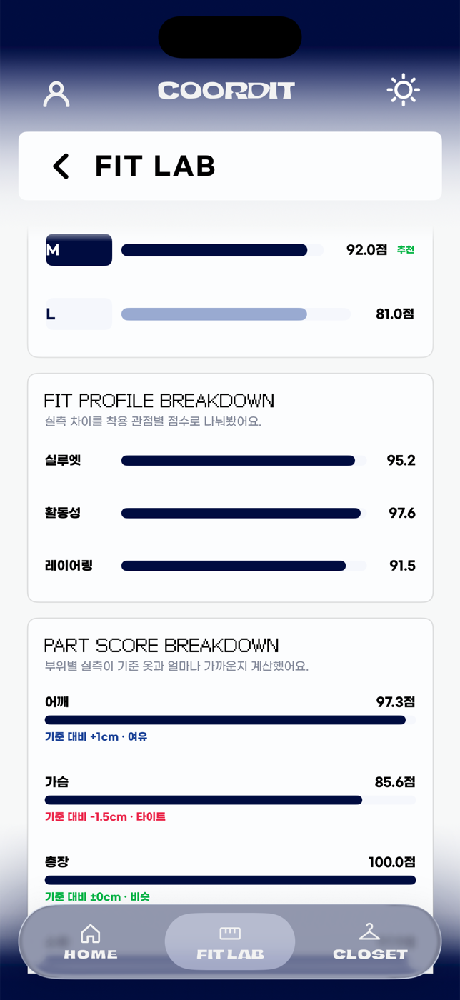
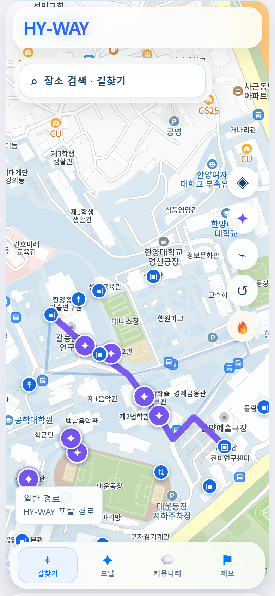

# IN SIHWAN

**SOFTWARE DEVELOPER**

**Hanyang University**  
Department of Information Systems

 

 

## 01 / ABOUT

I'm an Information Systems student at Hanyang University,
interested in building practical and scalable software.

My primary focus is backend engineering, with experience
in full-stack development, database architecture,
and turning ideas into working products — from mobile
apps to production websites that real businesses run on.

 

## 02 / SELECTED WORK

> Click **Details** under each project to expand the engineering notes.

 

### [HOWEON Corporate Website ↗](https://howeon-site.pages.dev/#/)

**Industrial Web · Real-time 3D Product Showcase · Client Project**

  
  &nbsp;
  

A corporate website for a water-treatment equipment and plant engineering company.
Interactive Three.js models show how each machine works, while 34 products,
49 projects and 16 certifications are managed as structured content.

-555?style=flat-square)

<b>Details — Key Engineering & Technology</b>

 

**Key Engineering**
- Migrated a monolithic vanilla JS page to a modular Vite build
  without changing the existing visuals (verified by 22-shot pixel diff)
- Real-time 3D product viewers with lazy-loaded model chunks,
  adaptive quality and WebGL failure fallbacks
- JSON content model with schema validation and reference checks
  across products, projects, certificates and patents
- Local admin tool for staff edits — scrypt auth, CSRF protection,
  upload validation, change history and restore
- Automated quality pipeline: unit tests, Playwright E2E on
  Chromium / WebKit / Firefox at 4 viewport widths, build output audit
- Mobile-first navigation and filtering, deployed on Cloudflare Pages

**Technology**
`JavaScript` · `Three.js` · `GSAP` · `Vite` · `Node.js` · `Playwright` · `GitHub Actions` · `Cloudflare Pages`

 

---

### [coordit ↗](https://github.com/ganadidududu/coordit)

**Fashion Technology · Measurement-based Fit Analysis · Team Project**

  
  &nbsp;
  
  &nbsp;
  

An iOS & Android app that recommends the right size by comparing a product's
size chart with the measurements of clothes you already fit well —
instead of guessing what "M" means at each brand.

<b>Details — Key Engineering & Technology</b>

 

**Key Engineering**
- Deterministic Fit Score Engine — weighted, tolerance-normalized
  Huber loss across 11 garment categories
- Multi-garment reference profile using weighted median and
  Huber-corrected mean to reduce outlier impact
- REST API with Supabase token verification, per-user data scoping
  and owner-based RLS policies
- Atomic writes for closet, analysis and credit usage via
  SQL RPC with idempotency keys
- LLM-generated fit reports grounded in engine results,
  with validated fallback explanations
- Size-chart import from product URLs (Playwright · Cheerio)

**Technology**
`TypeScript` · `Node.js` · `Express` · `Zod` · `PostgreSQL` · `Supabase` · `Docker`

 

---

### [HY-WAY ↗](https://hy-way.vercel.app)

**Campus Navigation · Graph-based Pathfinding · Independent Project**

  
  &nbsp;
  
  &nbsp;
  

A navigation service for Hanyang University's Seoul campus that finds
the routes students actually take — through buildings, stairs and elevators
("portals") that regular map apps don't know about.

<b>Details — Key Engineering & Technology</b>

 

**Key Engineering**
- Graph-based pathfinding over campus nodes and edges
- Side-by-side comparison of normal and portal-shortcut routes
- Accessibility-aware routing with slopes, stairs and elevators
- GPS start point snapped to the nearest graph node
- Building-based community and route reports on Supabase,
  storing distance only — never exact coordinates

**Technology**
`JavaScript` · `Vite` · `Kakao Maps API` · `Supabase` · `Vercel`

 

## 03 / TECHNICAL STACK

<table>
  <tr>
    <td><b>Languages</b></td>
    <td>      </td>
  </tr>
  <tr>
    <td><b>Frontend</b></td>
    <td>     </td>
  </tr>
  <tr>
    <td><b>Backend</b></td>
    <td>   </td>
  </tr>
  <tr>
    <td><b>Database</b></td>
    <td>  </td>
  </tr>
  <tr>
    <td><b>Infra &amp; Tools</b></td>
    <td>     </td>
  </tr>
</table>

 

## 04 / CURRENT INTERESTS

Backend Architecture · Full-Stack Engineering  
AI-Powered Applications · Database Systems

 

---

**IN SIHWAN**

Hanyang University · Information Systems

[ian24665003@gmail.com](mailto:ian24665003@gmail.com) · [ian5003@naver.com](mailto:ian5003@naver.com) · [GitHub](https://github.com/vaxxerz)

Designed with simplicity in mind.

